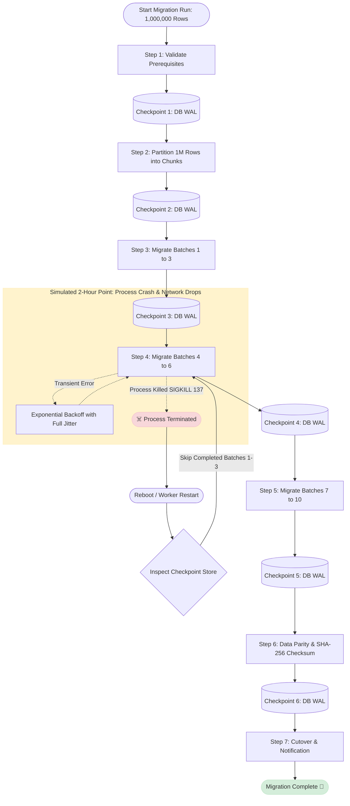

# Durable State Machine Workflow

A production-grade, fault-tolerant workflow orchestrator designed for multi-hour data migration pipelines.

Built to solve the critical flaw of naive `while True` scripts: unhandled process termination (Kubernetes OOMKills, Spot instance terminations, rolling deploys, transient network drops) destroying in-memory state and resetting long-running jobs back to zero.**

---

## Architecture Overview



---

## Key Highlights

- **Durable Checkpointing**: Atomically snapshots state after every DAG node using SQLite with Write-Ahead Logging (`PRAGMA journal_mode=WAL;`).
- **Crash Recovery**: If the OS process dies (`os._exit(137)`), restarting the workflow skips all committed steps and resumes the unfinished task from disk.
- **Exponential Backoff with Full Jitter**: Protects failing downstream databases from the *Thundering Herd* problem during retries:
  $$\text{Delay} = \text{Uniform}(0, \min(\text{MaxInterval}, \text{Initial} \times \text{Factor}^{\text{Attempt}}))$$
- **Step Idempotency**: Each chunk execution is keyed with deterministic partition tokens so re-running after network failure never produces duplicate rows.
- **Zero Dependencies for Core Engine**: Standard library Python (`sqlite3`, `json`, `dataclasses`, `time`).
- **Production Framework Adapters**: Includes reference implementations for both **LangGraph** (`StateGraph`, `SqliteSaver`) and **Temporal** (`@workflow.defn`, `@activity.defn`, Heartbeats).

---

## Quickstart

Clone the repo and run the automated crash-and-recovery test:

```bash
git clone https://github.com/<your-username>/durable-state-machine.git
cd durable-state-machine

# Run the crash and recovery demonstration
python3 demo_crash_and_recover.py
```

### Live Test Output
```text
======================================================================
 DURABLE STATE MACHINE WORKFLOW DEMO: CRASH & RECOVERY TEST
======================================================================

[PHASE A] Starting fresh workflow with simulated fatal crash trigger...
[Step 1] Validating source and target databases...
  -> Schema verification: PASSED
[Step 2] Calculating data volume and partitioning into chunks...
  -> Total records to migrate: 1,000,000
[Step 3] Processing Batches 1 to 3 (Records 1 - 300,000)...
     [Batch 1 Committed] Cumulative: 100,000 records.
     [Batch 2 Committed] Cumulative: 200,000 records.
     [Batch 3 Committed] Cumulative: 300,000 records.
[Step 4] Processing Batches 4 to 6 (Records 300,001 - 600,000)...
   [Simulated Transient Network Drop] Target DB connection reset!
  ⏳ Backing off for 0.17s before retry #2...
💀 [SIMULATED DISASTER] Process crashed / killed mid-migration during Phase 2!
🛑 Process 1 Exit Code: 137 (SIGKILL / OOM)

======================================================================
  [PHASE B] SIMULATING SERVER REBOOT & WORKER RESUMPTION
======================================================================
 [Crash Recovery] Found existing run! Resuming from state after 'migrate_phase_1'.
 Skipping 3 already completed steps: ['partition_and_plan', 'validate_prerequisites', 'migrate_phase_1']
  [Executing Step] --> 'migrate_phase_2'
  -> Migrating Batch 4 (IDs 300,001 - 400,000)...
  -> Migrating Batch 5 (IDs 400,001 - 500,000)...
  -> Migrating Batch 6 (IDs 500,001 - 600,000)...
...
[Step 6] Running Data Parity & Checksum Verification...
  -> SHA-256 Hash Parity: MATCHED (Zero data loss)
======================================================================
🎯 TEST SUCCESSFUL! Complete crash recovery achieved!
======================================================================
```

---

## Project Structure

```text
durable-state-machine/
├── .github/workflows/
│   └── ci.yml                 # Automated CI running tests across Python 3.9 - 3.12
├── core/
│   └── engine.py              # Zero-dependency durable workflow engine (ACID Checkpointing, Backoff)
├── migration_workflow.py      # 4-Hour data migration DAG (1M records, 10 partitions)
├── demo_crash_and_recover.py  # Interactive crash & recovery simulation script
├── langgraph_workflow.py      # Production LangGraph implementation (StateGraph, SqliteSaver)
├── temporal_workflow.py       # Production Temporal implementation (Activities, Heartbeats)
├── tests/
│   └── test_engine.py         # Unit test suite verifying backoff, jitter, and recovery
├── requirements.txt           # Optional dependencies for LangGraph/Temporal adapters
├── LICENSE                    # MIT License
└── README.md                  # Documentation & Architecture Guide
```

---

## Running Unit Tests

```bash
python3 -m unittest discover tests
```

---

## Framework Comparison: Temporal vs. LangGraph

| Feature | Temporal | LangGraph |
| :--- | :--- | :--- |
| **Primary Domain** | Distributed Microservices & Critical Infrastructure | LLM Agents, Multi-turn RAG, Tool Use Chains |
| **Durable Execution** | Event Sourcing & History Replay engine | Checkpointer snapshots (Postgres / SQLite) |
| **Crash Recovery** | Automatic worker reassignment + Replay | Thread-ID checkpoint resumption |
| **Failure Detection** | Activity Heartbeats with sub-minute timeouts | Node-level retry policies & exception handlers |
| **Hosting** | Temporal Cloud or Self-hosted Temporal Server (Go) | Embedded Python library or LangGraph Cloud |

---
## License

This project is licensed under the MIT License - see the [LICENSE](LICENSE) file for details.
